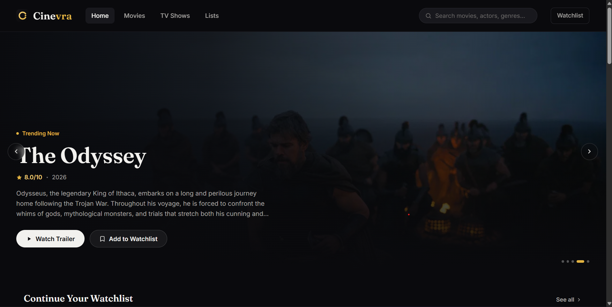

# Cinevra

Cinevra adalah aplikasi web untuk menjelajahi film dan serial TV dengan tampilan modern, gelap, dan sensasi sinematik. Proyek ini dibangun menggunakan HTML, CSS, dan JavaScript murni, dengan data dari TMDB API.



## Tentang proyek

Cinevra dirancang untuk membantu kamu:

- Menemukan film dan series yang sedang populer
- Melihat detail sinopsis, trailer, cast, genre, dan judul serupa
- Menyimpan judul favorit ke watchlist
- Membandingkan dan memfilter katalog berdasarkan genre, tahun, negara, serta platform streaming
- Menyimpan aktivitas personal seperti rating, catatan, riwayat menonton, dan progress episode

## Fitur utama

- Katalog film dan TV populer
- Halaman detail lengkap dengan poster, overview, trailer, cast, dan rekomendasi
- Watchlist berbasis browser dengan `localStorage`
- Filter multi-kriteria: genre, tahun, negara, dan platform streaming
- My Space untuk:
  - backup & restore data library
  - statistik pribadi
  - rekomendasi "For You"
- Dukungan tampilan desktop dan mobile

## Teknologi yang dipakai

- HTML5
- CSS3 (Flexbox, Grid, custom properties)
- JavaScript ES6+
- TMDB API
- localStorage untuk data lokal pengguna

## Persiapan cepat

Ikuti langkah berikut untuk menjalankan proyek di lingkungan lokal.

1. Buat API key dari [The Movie Database](https://www.themoviedb.org/)
2. Salin file contoh berikut:

```bash
cp js/config.example.js js/config.js
```

3. Buka `js/config.js` lalu isi nilai `TMDB_API_KEY` dengan API key yang kamu miliki
4. Jalankan server lokal

```bash
python -m http.server 5500
```

5. Buka browser ke alamat berikut:

```text
http://localhost:5500
```

## Deployment

Untuk deploy ke Netlify, Vercel, atau hosting lain, set environment variable berikut:

```bash
TMDB_API_KEY=your_tmdb_api_key_here
```

Saat proses build berjalan, script `scripts/generate-config.js` akan otomatis menulis isi `js/config.js` berdasarkan environment variable tersebut.

Gunakan `npm run build` sebagai build command di pengaturan hosting.

## Struktur proyek

```text
cinevra/
├── assets/
│   └── images/
├── css/
│   ├── style.css
│   ├── home.css
│   ├── movies.css
│   ├── search.css
│   ├── detail.css
│   └── watchlist.css
├── js/
│   ├── config.example.js
│   ├── config.js
│   ├── main.js
│   ├── home.js
│   ├── movies.js
│   ├── tv-shows.js
│   ├── search.js
│   ├── detail.js
│   ├── watchlist.js
│   ├── library.js
│   ├── my-space.js
│   └── personal.js
├── scripts/
│   ├── generate-config.js
│   ├── test-personal.js
│   ├── test-personal-ui.js
│   ├── test-streaming.js
│   ├── test-streaming-ui.js
│   ├── test-library.js
│   └── test-library-browser.js
├── index.html
├── movies.html
├── tv-shows.html
├── search.html
├── detail.html
├── watchlist.html
├── my-space.html
├── person.html
├── package.json
├── README.md
├── .gitignore
└── ...
```

## Catatan penting

- File `js/config.js` tidak disimpan di GitHub karena berisi API key pribadi
- Gunakan `js/config.example.js` sebagai template saat setup awal
- API key digunakan oleh aplikasi di browser. Batasi penggunaannya melalui pengaturan key TMDB dan jangan gunakan secret server-side di aplikasi client-side.
- Data film dan serial TV berasal dari TMDB
- Proyek ini dibuat untuk kebutuhan belajar dan eksplorasi frontend, serta tidak berafiliasi secara resmi dengan TMDB

## Fitur personal library

Cinevra juga memiliki fitur personal yang cukup lengkap di halaman My Space:

- Backup & Restore data library ke file JSON
- Rating pribadi dari 1 sampai 10
- Catatan dan tanggal menonton
- Progress episode untuk serial TV
- Statistik film dan acara yang sudah ditonton
- Rekomendasi yang disesuaikan dengan preferensi pengguna

## Testing

Beberapa script pengujian yang tersedia:

```bash
node scripts/test-personal.js
node scripts/test-personal-ui.js
node scripts/test-streaming.js
node scripts/test-streaming-ui.js
node scripts/test-library.js
```

Untuk pengecekan browser tertentu, tersedia juga:

```bash
node scripts/test-library-browser.js
```

## Pembuat

Dibuat oleh Rafif Shula Syandana untuk proyek pembelajaran web dan eksplorasi pengalaman menonton secara personal.

## Lisensi

Proyek ini dibuat untuk kebutuhan belajar dan penggunaan pribadi. Silakan sesuaikan dan modifikasi sesuai kebutuhanmu.
